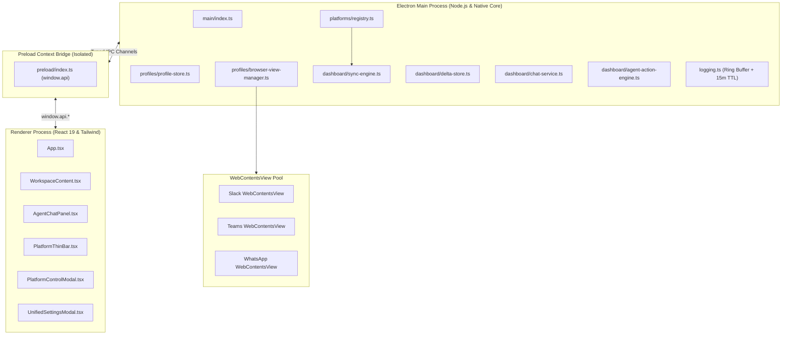

# Cosmic System Architecture & Modular Platform Design

## Overview
**Cosmic** is an autonomous desktop workspace and communication hub built on **Electron 44**, **TypeScript 5.9**, **React 19**, and **Tailwind CSS**.

Cosmic delivers unified communication across **Slack**, **Microsoft Teams**, and **WhatsApp Web**, featuring sub-150ms Zero-DOM direct ingestion, autonomous AI response generation with RAG context grounding, strict per-profile session isolation, and granular permission controls.

---

## 1. Process Architecture & Security Boundaries

### Security & Isolation Invariants
- **Strict Context Isolation**: `contextIsolation: true` and `nodeIntegration: false` enforced across all renderers and web views.
- **Partition Sandboxing**: Each profile and card runs under an isolated session partition (`persist:profile-<id>-<platform>` or `persist:card-<id>-<platform>`). Cookies and authentication stores never cross boundaries.
- **Offscreen View Retention**: Views remain attached to `mainWindow.contentView` at `(-10000, -10000)` when hidden. This preserves window handles for background IME text input, clipboard operations, and DOM evaluation without visual interference.
- **Sensitive Token Redaction**: Tokens (`xox*`, `nvapi-*`, Bearer headers, passwords) are scrubbed before hitting memory logs or IPC streams.

---

## 2. Modular Platform Suites Architecture

Cosmic implements a pluggable architecture via `PlatformBackendRegistry` (`src/main/platforms/registry.ts`), with each platform adhering to `IPlatformBackendAdapter`:

| Suite | Implementation Path | Ingestion Engines Supported | Extraction Method |
|---|---|---|---|
| **Slack** | `src/main/platforms/slack/slack-platform-suite.ts` | `direct_api`, `browser` | Cookie xoxc token + Web API / DOM |
| **Microsoft Teams** | `src/main/platforms/teams/teams-platform-suite.ts` | `direct_api`, `browser` | Zero-DOM IndexedDB `replychain` / DOM |
| **WhatsApp Web** | `src/main/platforms/whatsapp/whatsapp-platform-suite.ts` | `direct_api`, `browser` | Internal `Store.Msg` collection / DOM |

---

## 3. Core Specifications & Guides Index

For exhaustive technical references, see the companion documents:
- 📖 [COSMIC_SYSTEM_SPECIFICATION.md](file:///home/creator/Desktop/Orbit-Dashboards/Building-cosmic/docs/COSMIC_SYSTEM_SPECIFICATION.md): Deep-dive into dual-engine scraping, RAG context pipeline, message normalization, and slash commands.
- 🛡️ [PERMISSIONS_AND_HIERARCHY.md](file:///home/creator/Desktop/Orbit-Dashboards/Building-cosmic/docs/PERMISSIONS_AND_HIERARCHY.md): Complete guide to global/client account hierarchy, the permission triad (`enabled`, `agentWrite`, `autoReply`), 6 Auto-Reply Policies, and 6 AI Personas.
- 🎛️ [CONTROLLER_PAGE_GUIDE.md](file:///home/creator/Desktop/Orbit-Dashboards/Building-cosmic/docs/CONTROLLER_PAGE_GUIDE.md): Interactive manual for the Platform Control Modal, channel discovery, scheduling, audit logs, and engine switching.
- 🏛️ [FINAL_COSMIC_DUAL_REPO_STABILIZATION_POLICY.md](file:///home/creator/Desktop/Orbit-Dashboards/Building-cosmic/FINAL_COSMIC_DUAL_REPO_STABILIZATION_POLICY.md): Dual-repo stabilization gates and zero-bloat invariants.
- 📚 [GLOSSARY.md](file:///home/creator/Desktop/Orbit-Dashboards/Building-cosmic/GLOSSARY.md): Shared domain vocabulary.
