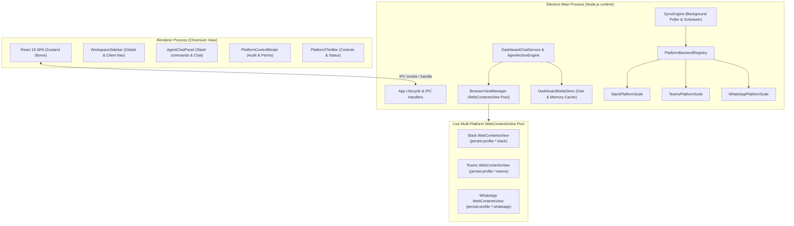
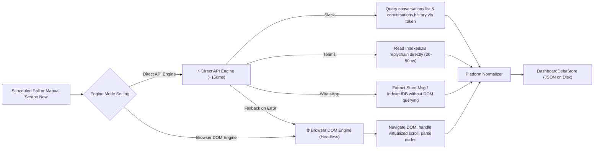
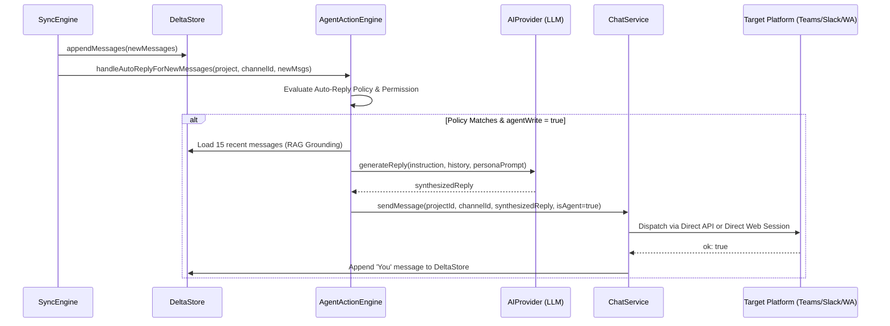

# Cosmic Autonomous Agent: System Specification & Architecture Manual

## 1. System Mission & Overview

Cosmic is a high-performance, multi-platform desktop client and autonomous agent workstation built on **Electron 44**, **TypeScript 5.9**, **React 19**, and **Tailwind CSS**. 

Cosmic unifies real-time communication across disparate enterprise collaboration platforms—**Slack**, **Microsoft Teams**, and **WhatsApp Web**—into a single cockpit. It provides:
1. **Ultra-Low Latency Ingestion**: Ingesting messages via Zero-DOM direct APIs in under 150ms.
2. **Autonomous AI Auto-Reply & Dispatch**: Context-grounded RAG assistance across 6 enterprise personas.
3. **Multi-Session Isolation**: Strict per-profile and per-card Electron partition sandboxing.
4. **Universal Control & Audit Infrastructure**: Centralized permission management, scheduling, and live scrape logs.

---

## 2. Multi-Process Architecture



### 2.1 Process Responsibilities
- **Main Process**: Owns native OS integration, window management, partition configuration, background timer scheduling, delta file storage, secure credential isolation, and platform suite dispatching.
- **Renderer Process**: Single Page Application (SPA) driven by React 19, Zustand stores, and Tailwind CSS. Isolated from Node.js; communicates exclusively via context-isolated preload IPC channels (`window.api`).
- **WebContentsView Pool**: Headless and visual WebContentsViews hosting authenticated live web sessions (Slack, Teams, WhatsApp). Views remain retained and attached offscreen at `(-10000, -10000)` to ensure uninterrupted background script execution, IME input, and DOM accessibility.

---

## 3. Multi-Platform Ecosystem

Cosmic integrates three primary platforms via dedicated platform suites adhering to the `IPlatformBackendAdapter` interface contract:

| Platform | Authentication / Session Origin | Default Storage / Session Partition | Ingestion Capabilities |
|---|---|---|---|
| **Slack Workspace** | Enterprise OAuth or In-Page Cookie (`d`, `d-s`) | `persist:profile-<id>-slack` | Direct Web API + DOM View fallback |
| **Microsoft Teams** | Microsoft Account / O365 SSO Session | `persist:profile-<id>-teams` | Zero-DOM IndexedDB + DOM View fallback |
| **WhatsApp Web** | Multi-Device Linked Session (QR Auth) | `persist:profile-<id>-whatsapp` | Store.Msg / IndexedDB + DOM View fallback |

---

## 4. Dual-Engine Ingestion Architecture

Every platform in Cosmic supports dual ingestion modes selectable by the user in the Platform Control Modal:



### 4.1 ⚡ Direct API Engine (~150ms Zero-DOM)
- **Slack**:
  - `sessionTokenExtractor` inspects the partition's cookies (`d`, `d-s`) and extracts the workspace xoxc/xoxd tokens.
  - Queries `conversations.list` and `conversations.history` directly over HTTPS.
  - Ingestion completes in **~120ms–150ms** with zero DOM overhead, zero scrolling, and zero GPU utilization.
- **Microsoft Teams**:
  - Teams stores real-time messages in client-side IndexedDB databases: `replychain`, `streams-replychain`, and `Teams:*`.
  - `buildTeamsDirectReadScript` opens the IndexedDB instance in the page's execution context and reads message records matching the conversation ID or target name.
  - Ingestion completes in **~20ms–50ms** without virtual DOM queries or DOM hydration delays.
- **WhatsApp Web**:
  - Accesses WhatsApp's internal message cache `window.Store.Msg` and IndexedDB collections directly.
  - Extracts message collections with sender, timestamp, and message body without triggering scroll events.

### 4.2 🌐 Browser DOM Engine (Headless WebContentsView Fallback)
- Used as an automatic fallback if Direct API tokens expire or client-side databases are uninitialized.
- Dispatches channel navigation clicks, awaits DOM hydration, tracks virtualized scrolling viewports, and scrapes raw DOM nodes:
  - Slack: `div[data-qa="message_container"]`
  - Teams: `div[data-tid="message-pane-list-viewport"] [role="listitem"]`
  - WhatsApp: `div[role="row"] div[data-pre-plain-text]`

---

## 5. Message Normalization & Delta Storage

All ingested messages from any engine are transformed into the canonical schema:

```typescript
export interface DashboardStoredMessage {
  id?: string               // Unique message identifier
  ts: string                // Normalized microsecond timestamp: '1731456000.000000'
  user?: string             // Sender display name or identifier
  text: string              // Clean plaintext with HTML entities unescaped
  source: 'client' | 'team' // Project source role
  channelId?: string        // Canonical channel ID
  channelName?: string      // Canonical channel name
  isBot?: boolean           // Bot flag
  subtype?: string          // Subtype (e.g. 'bot_message')
}
```

### 5.1 Storage Layout
Messages are persisted under `~/.config/slack-dashboard/dashboard/chat/` as JSON deltas:
- `proj-<id>_ch_<channelId>.json`
- In-memory LRU activity cache ensures sub-millisecond retrieval for dashboard chat UI and RAG context windows.

---

## 6. Real-Time Autonomous Agent & RAG Pipeline

When messages arrive in the Delta Store, Cosmic's autonomous agent pipeline evaluates auto-reply triggers and generates grounded responses:



### 6.1 RAG Grounded Context Window
Before generating an answer, Cosmic automatically retrieves the **15 most recent messages** from the target conversation. This context is injected into the prompt along with the sender's identity, ensuring responses are deeply relevant and avoid repetitive questions.

---

## 7. Interactive Slash Commands

The `AgentChatPanel` composer supports interactive commands:

| Command Syntax | Execution Mode | Behavior |
|---|---|---|
| `/send @account #channel : <text>` | Direct API (~150ms) / Web Session | Posts the exact verbatim text following the colon directly to the target channel. |
| `/ai-ans @account #channel [persona] : <query>` | AI Grounded RAG + Dispatch | Ingests 15 recent messages, synthesizes an intelligent answer using the specified persona, and posts it. |
| `/scrape` | Immediate Background Sync | Triggers an immediate delta sync cycle across all enabled channels. |
| `/help` or `/help-slack` | Cheatsheet Card | Displays interactive guide of all commands, accounts, channels, and active policies. |
| `@<platform>` | Popover Autocomplete | Quickly targets a connected workspace account (`@slack`, `@teams`, `@whatsapp`). |
| `#<channel>` | Popover Autocomplete | Quickly targets a monitored channel or DM contact. |
