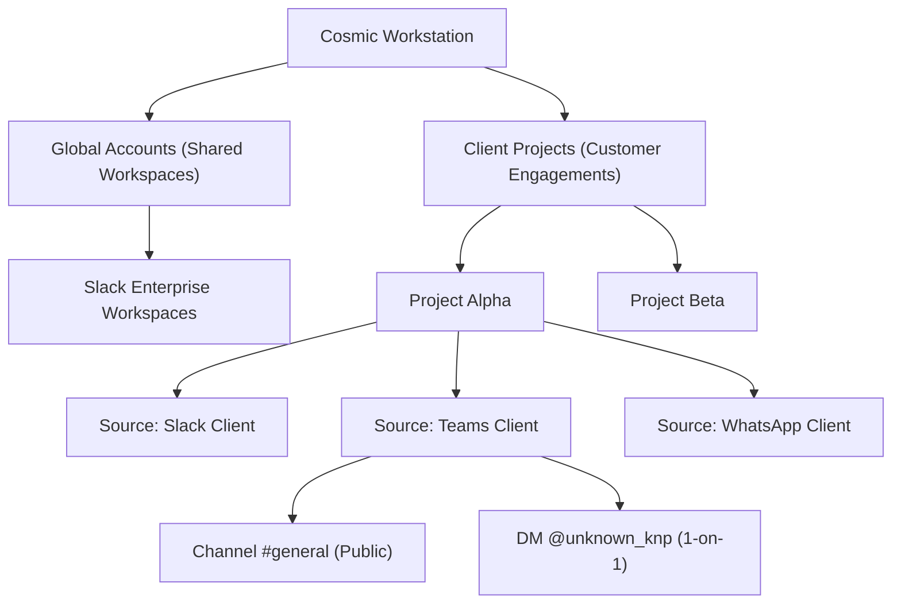
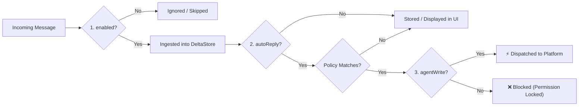

# Cosmic Permissions, Hierarchy & Controller Suites Specification

## 1. Hierarchy & Scoping Architecture

Cosmic implements a multi-tier hierarchy to govern communication boundaries, data isolation, and execution authority:



### 1.1 Account Tiers
1. **Global Accounts**:
   - Pinned at the organization level (e.g. your company's internal Slack).
   - Available across all projects for internal collaboration, monitoring, and team dispatch.
2. **Client Accounts**:
   - Scoped strictly to specific client engagements or projects.
   - Pinned to isolated profiles (`persist:profile-<id>-<platform>`), ensuring client credentials and message stores never leak across client boundaries.
3. **Monitored Channels & DMs**:
   - Granular communication endpoints within each account: public channels, private channels, shared channels, and 1-on-1 direct messages.
   - Every individual channel/chat carries its own independent permission flags.

---

## 2. The Permission Triad

Every monitored channel and DM within Cosmic possesses three independent permission gates:



| Permission Gate | Property Key | Default Value | Capability Authorized When Enabled |
|---|---|---|---|
| **Listen & Ingest** | `enabled` | `true` | The sync engine polls and stores messages from this channel. If `false`, the channel is skipped during scraping. |
| **Agent Write** | `agentWrite` | `false` | Authorizes Cosmic (via slash commands, AI answers, or manual messages) to post messages to this channel. |
| **Autonomous Auto-Reply** | `autoReply` | `false` | Enables the background autonomous listener to trigger AI replies when new incoming messages are detected. |

> [!IMPORTANT]
> **Safety Invariant**: Even if `autoReply` is toggled `true`, Cosmic will **never** post a response unless `agentWrite` is also explicitly granted. If `agentWrite` is missing, Cosmic surfaces a `permission_denied` card prompting the operator to authorize the channel in Workspace Control.

---

## 3. The 6-Tier Auto-Reply Policy Matrix

When `autoReply` and `agentWrite` are active, Cosmic evaluates the incoming message against the channel's active **Auto-Reply Policy**:

| Policy ID | Label & Icon | Trigger Evaluation Logic | Ideal Use Case |
|---|---|---|---|
| `none` | 🛑 **No Auto-Reply** | Always returns `false`. Cosmic acts as a silent listener and delta synchronizer. | High-noise announcement channels; read-only tracking. |
| `all` | ⚡ **Reply to All** | Returns `true` for every incoming message sent by another person (ignores self messages and bots). | Dedicated customer support DMs; 24/7 immediate acknowledgment. |
| `smart` | 🧠 **Smart Needs-Reply** | Analyzes the message text for interrogative patterns (`?`, `who`, `what`, `where`, `when`, `why`, `how`, `could you`, `can we`, `please`, `status`, `update`). | Client project channels where general chatter is ignored but explicit requests trigger help. |
| `task` | 📋 **Task & Project Only** | Evaluates message content for task-related keywords (`task`, `bug`, `fix`, `deliverable`, `milestone`, `blocker`, `deadline`, `commit`, `pr`, `deploy`). | Engineering and sprint planning channels. |
| `mention_dm` | 👤 **Mention & DM Only** | Returns `true` only if the message is in a 1-on-1 Direct Message (DM) or if Cosmic's account username is explicitly tagged (`@name`). | Shared multi-party channels where the bot must speak only when spoken to. |
| `draft` | 📝 **Draft Approval Mode** | Synthesizes the AI response and surfaces it as an interactive draft card in chat with an `Approve & Send` button. | High-stakes client communication where human-in-the-loop review is mandatory before posting. |

---

## 4. The 6 AI Response Personas

Cosmic includes 6 distinct prompt personas tailored for enterprise communication. These personas govern tone, formatting, and brevity for both `/ai-ans` commands and autonomous auto-replies:

1. **👔 Professional (Default)**
   - *Tone*: Formal, crisp, respectful, enterprise-grade.
   - *Style*: Clear sentence structure, business vocabulary, polite salutations and sign-offs.
2. **😊 Friendly & Warm**
   - *Tone*: Approachable, cheerful, supportive, encouraging.
   - *Style*: Conversational, empathetic, uses occasional positive emoji, warm opening.
3. **⚡ Direct & Concise**
   - *Tone*: Minimalist, action-oriented, zero fluff.
   - *Style*: Bullet-pointed deliverables, answers questions in 1–2 sentences, eliminates greetings.
4. **🤝 Empathetic ("Good Person")**
   - *Tone*: Patient, highly understanding, client-advocate.
   - *Style*: Acknowledges difficulties, validates user concerns, reassures with solutions.
5. **🛠️ Technical & Detailed**
   - *Tone*: Analytical, precise, architectural.
   - *Style*: Includes code blocks, file references, specific metrics, error codes, and step-by-step logic.
6. **📊 Executive Summary**
   - *Tone*: High-level, strategic, decision-focused.
   - *Style*: Lead with the bottom line (BLUF), summarizes impact, outlines next steps and blockers.

---

## 5. Controller Suites Architecture (`IPlatformBackendAdapter`)

Every platform suite implements the unified backend adapter interface defined in `src/shared/platforms/platform-contract.ts`:

```typescript
export interface IPlatformBackendAdapter {
  readonly metadata: PlatformMetadata

  discoverChannels(ctx: PlatformDiscoveryContext): Promise<PlatformDiscoveryResult>
  scrapeChannels(ctx: PlatformScrapeContext): Promise<PlatformScrapeResult>
  postMessage?(channelId: string, text: string, expectedName?: string): Promise<boolean>
}
```

### 5.1 `SlackPlatformSuite` (`src/main/platforms/slack/`)
- **Metadata**: id: `'slack'`, icon: `'slack'`, engine modes: `['direct_api', 'browser']`.
- **Channel Discovery**:
  - Direct API: Queries Slack Web API `conversations.list` with user token extracted from session cookies.
  - Browser DOM Fallback: Scrapes sidebar DOM nodes via `SlackReaderView`.
- **Message Ingestion**:
  - Direct API: Queries `conversations.history` with timestamp windowing.
  - Browser DOM Fallback: Virtualized scrolling and DOM extraction.
- **Message Dispatch**:
  - Calls Slack Web API `chat.postMessage` directly in ~150ms.

### 5.2 `TeamsPlatformSuite` (`src/main/platforms/teams/`)
- **Metadata**: id: `'teams'`, icon: `'teams'`, engine modes: `['direct_api', 'browser']`.
- **Channel Discovery**:
  - Inspects Teams chat list nodes: `[data-tid="team-channel-item"]`, `[data-tid="chat-list-item"]`.
- **Message Ingestion**:
  - Direct API (~20-50ms): Queries IndexedDB `replychain` & `Teams:*` object stores Zero-DOM.
  - Browser DOM Fallback: Evaluates `TEAMS_READ_MESSAGES_SCRIPT` across `[role="listitem"]`.
- **Message Dispatch**:
  - Direct Web Session: Scopes target composer away from top search bar, simulates native IME text insertion, enables Send button, dispatches pointer events and native Return key, with delivery confirmation.

### 5.3 `WhatsAppPlatformSuite` (`src/main/platforms/whatsapp/`)
- **Metadata**: id: `'whatsapp'`, icon: `'whatsapp'`, engine modes: `['direct_api', 'browser']`.
- **Channel Discovery**:
  - Inspects `#pane-side div[role="listitem"]` and extracts chat titles, phone numbers, and unread badges.
- **Message Ingestion**:
  - Direct API: Queries WhatsApp internal `Store.Msg` collection without DOM manipulation.
  - Browser DOM Fallback: Scrapes `#main div[role="row"]` and parses `data-pre-plain-text`.
- **Message Dispatch**:
  - Direct Web Session: Resolves active chat title, focuses Lexical editor, dispatches `beforeinput` + `input` events, clicks `[data-testid="compose-btn-send"]`.
